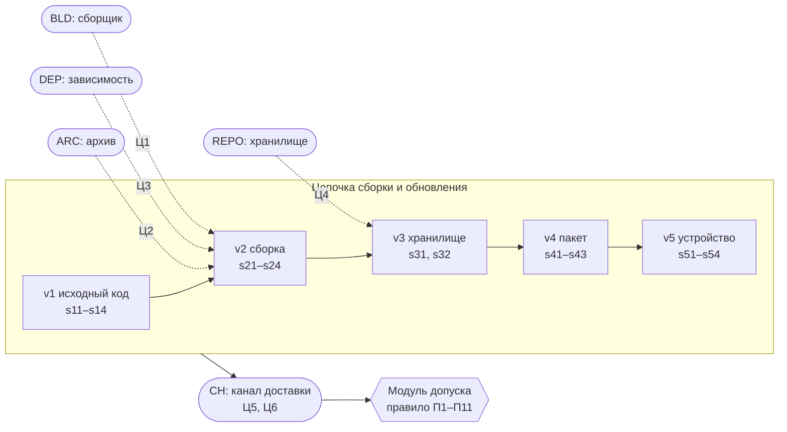

# scii-adversarial

[](https://github.com/alexqzm/scii-adversarial/actions/workflows/ci.yml)

Эмуляция атак на правило допуска обновлений SCII и сравнение его стойкости с другими правилами допуска. Объект испытаний — модуль допуска [scii-gate](https://github.com/alexqzm/scii-gate) (версия 0.1.5, DOI [10.5281/zenodo.24005892](https://doi.org/10.5281/zenodo.24005892)) на реальном конвейере сборки прошивки ArduPilot Copter-4.5.7 для платы CubeOrange.

Вопрос исследования простой. Нарушитель знает правило допуска, граф, веса и порог. Каких участников цепочки сборки и обновления ему нужно скомпрометировать, чтобы подменённая прошивка прошла гейт? И как это соотносится с подписью поставщика, проверкой SLSA, строгой схемой in-toto и другими правилами на тех же свидетельствах?

Программа эксперимента ([docs/PROTOCOL.md](docs/PROTOCOL.md)) зафиксирована до прогона, её SHA-256 записан в [docs/PROTOCOL.sha256](docs/PROTOCOL.sha256). Отклонений от неё нет ([docs/DEVIATIONS.md](docs/DEVIATIONS.md)). Все числа ниже взяты из [results/summary.md](results/summary.md), который генерирует программа.

## Модель нарушителя



- **Участники.** Держатели ключей и элементы инфраструктуры. Сборочный агент BLD, независимый исполнитель контрольной пересборки IND, хранилище REPO, службы статического анализа SAST и испытаний TEST. У поставщика ключи подписи пакета PKG, тегов TAG и защищённой загрузки SB. Точки внедрения ARC (архив исходников) и DEP (зависимость). Канал доставки CH и рецензент REV. Скомпрометированный участник подписывает что угодно от своего имени.
- **Действия.** Нарушитель предъявляет свидетельство честным, подделывает его ключом скомпрометированного участника, скрывает (через канал) или повторяет свидетельство текущего подлинного выпуска (через канал). Подпись без ключа не подделывается.
- **Цели.**
  - Ц1: внедрение на сборочном агенте (сценарий ПМИ A5a).
  - Ц2: сборка из архива, отличного от git (A3).
  - Ц3: подмена зависимости (A7).
  - Ц4: подмена образа в хранилище до подписи пакета.
  - Ц5: подмена пакета в канале после подписи (A1a).
  - Ц6: откат на подлинный предыдущий выпуск (A4).
- **Мера.** Семейство наборов участников, при которых правило допускает неподлинный образ, его минимальные элементы и k-стойкость (наименьший размер набора, аналог k-zero day safety). Правило не слабее другого, если его семейство вложено в семейство другого: тогда при любой стоимости компрометации участников самая дешёвая атака на него не дешевле.

Наилучшая для нарушителя запись вычисляется без перебора его действий. Для каждого свидетельства берётся наибольшее достижимое состояние в порядке «опровергнуто < отсутствует < подтверждено». Это корректно, потому что исходы «допуск» и «допуск или ручное рассмотрение» всех правил монотонны. Монотонность проверена полным перебором 531 441 записи и выборкой 100 000 записей: нарушений 0.

## Результаты

### Стойкость (вариант политики D1, участники по отдельности)

Наименьшее число участников, которых нужно скомпрометировать для допуска неподлинного образа. В скобках — для допуска или ручного рассмотрения, если отличается. ∞ — недостижимо.

| Правило | Ц1 сборка | Ц2 архив | Ц3 зависимость | Ц4 хранилище | Ц5 канал | Ц6 откат |
|---|---|---|---|---|---|---|
| П1 подпись поставщика | 1 | 1 | 1 | 1 | 3 | 1 |
| П2 подпись и защита от отката | 1 | 1 | 1 | 1 | 3 | ∞ |
| П3 проверка provenance SLSA | 1 | 2 | 1 | 2 | 4 | ∞ |
| П4 SLSA с контрольной пересборкой | 2 | 3 | 2 | 3 | 5 | ∞ |
| П5 бинарный контроль | 2 | 3 | 2 | 3 | 3 | 2 |
| П6 бинарный контроль с пересборкой | 2 | 3 | 3 | 3 | 4 | 3 |
| П7 строгая схема (in-toto) | 2 | 3 | 3 | 3 | 6 | ∞ |
| П10 SCII, правило (4) | 2 | 3 | 3 (2) | 3 | 6 (4) | ∞ |

Аддитивный индекс (П8), графовый индекс без вето (П9) и SCII с ящиком весов (П11) по допуску совпадают со строгой схемой и SCII.

- **SCII не слабее ни одного из десяти правил сравнения.** Его семейство успешных наборов вложено в семейство каждого из них. Подпись поставщика, SLSA и бинарный контроль он превосходит строго.
- **Совпадение со строгой схемой — следствие порога по эталону.** Если ни одно свидетельство вне эталона не может быть подтверждено, а каждая запись без одного свидетельства эталона ниже порога, то любое монотонное правило допускает ровно то, что строгая схема. Это доказано и подтверждено перебором (гипотеза Г3).
- **Случайная стоимость компрометации.** Стоимости равномерны на [1; 10], 10 000 наборов. Самая дешёвая атака на SCII ни разу не дешевле, чем на другое правило. Строго дороже она в 100 % наборов против П1–П3, в 62 % против бинарного контроля, в 12 % против бинарного контроля с пересборкой.
- **Откат.** Бинарный контроль пропускает его при двух участниках: сборщик и канал, который убирает из комплекта заявку на проверку версии. Проверки s51–s53 scii-gate выполняет, только если комплект их заявляет. SCII это переживает: без проверки версии падает полнота стадии устройства.

### Цена стойкости

| Решение о 4095 подлинных записях без части свидетельств | Допуск | Ручное рассмотрение | Запрос свидетельств | Отказ |
|---|---|---|---|---|
| П1 подпись поставщика, П5 бинарный контроль | 1023 | 0 | 0 | 3072 |
| П7 строгая схема | 0 | 0 | 0 | 4095 |
| П10 SCII | 0 | 462 | 3072 | 561 |

- **Строгая схема отклоняет любой неполный подлинный выпуск, SCII — 561 из 4095.** Остальные SCII направляет на запрос свидетельств, если нет обязательного, или на ручное рассмотрение.
- **Цена: путь к ручному рассмотрению.** Для целей Ц1–Ц4 наборы, при которых бинарный контроль допускает подменённый образ, в точности совпадают с наборами, при которых SCII направляет его на ручное рассмотрение. Подмена зависимости доходит до человека при двух участниках, подмена в канале при четырёх.

### Варианты политики

- **D2, без независимой пересборки.** Внедрение на сборочном агенте проходит при одном участнике для всех правил, которые допускают эталон. Агрегация не заменяет независимого свидетельства.
- **D3, якорь рецензента без рецензирования.** Найдена компенсационная атака. Сборщик, канал и ключ рецензента скрывают опровергающую пересборку и подделывают рецензию. R_P^min = 0,621 при пороге 0,496, и настоящий гейт допускает такой комплект. Строгая схема его отклоняет. Аддитивный индекс и SCII с ящиком весов в D3 допускают ещё и откат. Правило построения политики: якоря доверия только для свидетельств эталона, свидетельство, которое одно опровергает класс атак, обязательно.

### Эмуляция на артефактах

- **Перевыпуск ключей.** Закрытые ключи прогона ПМИ 30.10.2026 не сохранились, поэтому ключи всех ролей созданы заново (cosign, OpenPGP, Monocypher). Образы и содержимое свидетельств взяты из комплектов scii-gate. 16 сценариев ПМИ на перевыпущенном стенде дали те же 272 состояния и 16 решений (Г0).
- **Комплекты нарушителя.** Для каждой различной лучшей записи нарушителя собран настоящий комплект: подделки подписаны ключами участников, скрытые свидетельства удалены, повторённые скопированы. Каждый проверен `scii verify`. 208 комплектов в трёх вариантах политики и 124 комплекта с одиночными действиями: состояния 17 свидетельств и решения совпали с моделью во всех (Г7).

### Реализация гейта (scii-gate 0.1.5)

724 искажённых комплекта на основе подлинного B1 и трёх комплектов атак. Допусков неподлинного образа 0 (Г8). Найдены дефекты устойчивости:

- **Аварийное завершение без решения (304).** Путь вне комплекта, поле неверного типа, запись не того вида или испорченный `bundle.json` дают исключение Python и код выхода 1 вместо 0, 10, 20, 30.
- **Исчерпание памяти (8).** Символическая ссылка на `/dev/zero` вместо объекта коммита или тега: процесс гейта растёт до ~6 ГБ и завершается системой. Та же ссылка вместо аттестации так же исчерпывает память в cosign, но гейт выносит решение: проверка этого свидетельства не прошла.
- **Зависание (4).** Пакет — символическая ссылка на `/dev/zero`.
- **Выход за пределы комплекта.** Гейт следует по символическим ссылкам на файлы вне комплекта.
- **Без ограничения размера.** zlib-бомба на 1 ГиБ в образе обрабатывается около 11 с без ограничения размера.

Подробности: [results/summary.md](results/summary.md), [results/mutation.json](results/mutation.json).

## Воспроизведение

Нужны Python 3.11 (pymonocypher 3.1.3.2 под 3.13 не собирается), cosign v2.4.1, GnuPG и scii-gate на закреплённом коммите.

```bash
git clone https://github.com/alexqzm/scii-gate ../scii-gate
git -C ../scii-gate checkout d210811f27a9b9302f018faf7f019d38dfbb9227
python3.11 -m venv .venv && . .venv/bin/activate
pip install --require-hashes -r requirements.txt

python -m pytest -q                                  # модель, правила, результаты
python -m adv.analysis --out results/analysis.json   # перебор наборов (секунды)
python -m adv.monotonicity                           # монотонность правил (минуты)
SCII_COSIGN=/path/to/cosign python -m adv.emulate all   # Г0 и Г7 на артефактах (около 15 мин)
SCII_COSIGN=/path/to/cosign python -m adv.mutate        # искажённые комплекты (около 12 мин)
python -m adv.report                                 # results/summary.md
python -m adv.compare analysis NEW.json              # сверка свежего прогона с results/
```

`adv.mutate` содержит искажения, исчерпывающие память машины. В CI они пропускаются ключом `--skip-memory`.

## Состав

| Путь | Содержание |
|---|---|
| `docs/PROTOCOL.md` | программа эксперимента 1.0 и её SHA-256 |
| `adv/semantics.py` | участники, цели, честные состояния, действия нарушителя, лучшая запись |
| `adv/rules.py` | правила П1–П11 на ядре scii-gate |
| `adv/analysis.py` | семейства наборов, k-стойкость, доминирование, случайная стоимость, цена, пороговая кривая, D3 |
| `adv/monotonicity.py` | проверка монотонности исходов |
| `adv/emulate.py` | перевыпуск ключей, комплекты нарушителя, прогон `scii verify` |
| `adv/mutate.py` | искажённые комплекты |
| `results/` | результаты прогонов и сводка |
| `paper/vak6/` | рисунок и пересчёт чисел для статьи |

## Ссылки

- Метод и правило допуска: Кузьмин А.Р. «Метод оценки целостности цепочки сборки и обновления программного обеспечения на основе графа доказательств», «Вопросы кибербезопасности» (в редакции).
- Модуль допуска и стенд: [alexqzm/scii-gate](https://github.com/alexqzm/scii-gate).

## Лицензия

Apache-2.0, см. [LICENSE](LICENSE).
